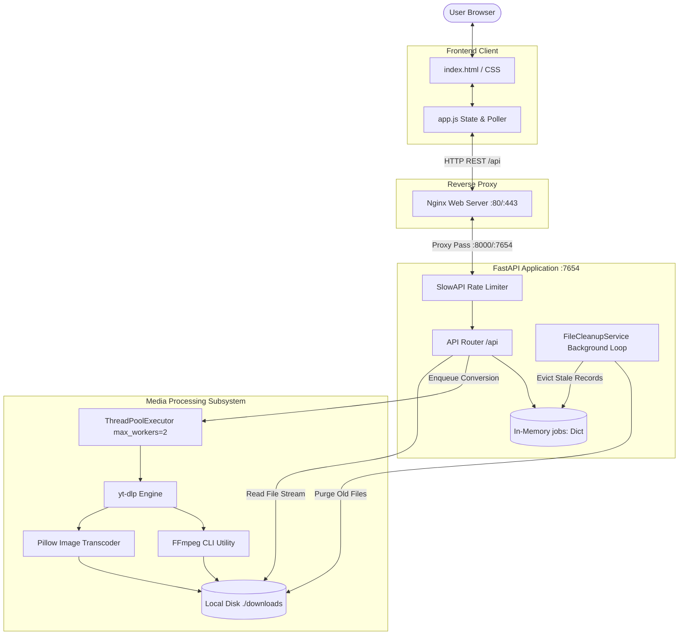
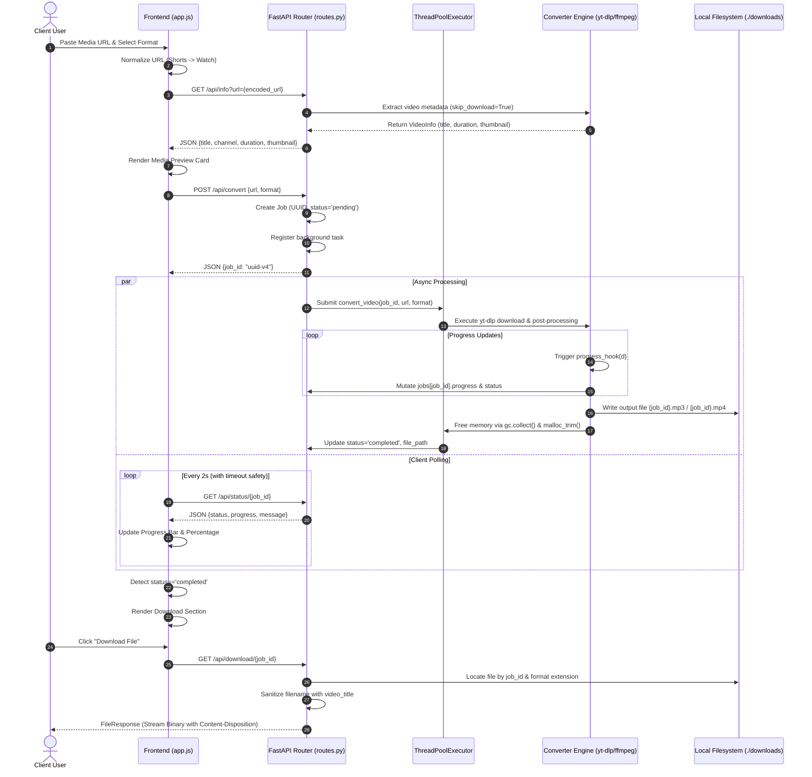
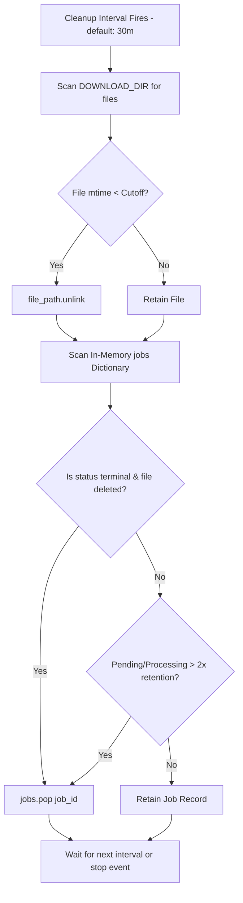

# Reelo – YT & Insta Converter: Technical Documentation

> **Last Updated:** October 20, 2026  
> **Application Version:** 1.0.0  
> **Repository Root:** `d:/Github/Reelo`  
> **Status:** Active / Production-Ready  

---

## Table of Contents

1. [Project Overview](#1-project-overview)
2. [Technology Stack](#2-technology-stack)
3. [Project Directory Structure](#3-project-directory-structure)
4. [Website UI and UX](#4-website-ui-and-ux)
5. [Feature Documentation](#5-feature-documentation)
6. [System Architecture](#6-system-architecture)
7. [Backend and API Reference](#7-backend-and-api-reference)
8. [Media Processing Pipeline](#8-media-processing-pipeline)
9. [Data Storage and File Lifecycle](#9-data-storage-and-file-lifecycle)
10. [Configuration and Environment Variables](#10-configuration-and-environment-variables)
11. [Installation and Development Setup](#11-installation-and-development-setup)
12. [Deployment and Production Operations](#12-deployment-and-production-operations)
13. [Security, Privacy, and Reliability](#13-security-privacy-and-reliability)
14. [Testing and Quality Assurance](#14-testing-and-quality-assurance)
15. [Current Implementation Status](#15-current-implementation-status)
16. [Extension and Integration Guide](#16-extension-and-integration-guide)
17. [Troubleshooting and FAQ](#17-troubleshooting-and-faq)
18. [Glossary and Reference](#18-glossary-and-reference)
19. [Documentation Scope and Verification](#19-documentation-scope-and-verification)

---

## 1. Project Overview

### 1.1 Purpose & Vision
**Reelo – YT & Insta Converter** is a high-performance, web-based utility engineered to extract, transcode, and download media streams from popular online platforms—primarily YouTube and Instagram (with regex support for Pinterest). The application eliminates bloated, ad-saturated experiences common to third-party media converters by providing a lightweight, modern, responsive interface backed by a modular asynchronous Python processing engine.

### 1.2 Core Capabilities
- **Audio Extraction & Transcoding**: Converts video streams into high-fidelity MP3 audio across multiple bitrates (48 kbps, 64 kbps, 128 kbps, 240 kbps, 320 kbps).
- **Video Fetching & Remuxing**: Downloads video streams up to 4K resolution (360p, 720p, 1080p, 1440p, 2160p) with automated video/audio stream merging via FFmpeg.
- **Thumbnail & Image Extraction**: Extracts high-resolution video thumbnails and cover art, converting them into PNG, JPG, or JPEG formats using Pillow (`PIL`), and packaging multi-asset sets into zip archives.
- **Asynchronous Non-blocking Processing**: Offloads heavy media downloads and transcoding to a dedicated thread pool executor with client-side polling and real-time progress hooks.
- **Automatic Resource Cleanup**: Periodically purges stale files from disk and evicts expired job records from server memory.
- **Stealth & Bot Evasion**: Features dynamic Chrome User-Agent rotation, request intervals, and anti-detection settings specifically tailored to handle Instagram and YouTube client verification.

### 1.3 Target Platforms & Supported Content
- **YouTube**: Standard videos (`watch?v=`), Shorts (`/shorts/`), Live streams (`/live/`), and YouTube Music (`music.youtube.com`).
- **Instagram**: Reels, regular posts (`/p/`), and IGTV videos (`/tv/`).
- **Pinterest**: Supported at the frontend URL-validation pattern level (`pin.it`, `pinterest.com/pin/`).

### 1.4 Known Limitations
- **Live Stream Conversion**: YouTube Live URLs are normalized to standard watch URLs, but ongoing live streams will fail or stall during full download/muxing because they lack a finalized end-of-file.
- **In-Memory Job State**: Job records are stored in a process-level Python dictionary (`jobs: Dict[str, JobStatus]`). Server restarts wipe active job metadata.
- **Single-Host Concurrency Ceiling**: The background worker thread pool is bounded to 2 workers to prevent memory exhaustion in containerized environments. Heavy concurrent usage leads to job queueing.
- **Instagram Cookie Expiration**: Authenticated extraction from Instagram relies on an optional Netscape-format cookie file (`INSTAGRAM_COOKIES_FILE`). Session expiration requires manual cookie renewal.

---

## 2. Technology Stack

### 2.1 Frontend
| Technology | Version / Specification | Purpose | Source Reference |
| :--- | :--- | :--- | :--- |
| **HTML5** | Semantic standard | Single-page UI layout, forms, progress bars | [`frontend/index.html`](file:///d:/Github/Reelo/frontend/index.html) |
| **Vanilla CSS3** | Custom design system | Slate/Indigo/Pink dark theme, glassmorphism, responsive grid | [`frontend/static/css/style.css`](file:///d:/Github/Reelo/frontend/static/css/style.css) |
| **Vanilla JavaScript (ES6+)** | Native ECMAScript | DOM manipulation, state management, adaptive polling | [`frontend/static/js/app.js`](file:///d:/Github/Reelo/frontend/static/js/app.js) |
| **Axios** | CDN release | Promise-based HTTP client for metadata and job conversion APIs | [`frontend/index.html:L339`](file:///d:/Github/Reelo/frontend/index.html#L339) |
| **Font Awesome** | 6.7.2 (CDN) | Modern vector icons for features and user interactions | [`frontend/index.html:L51`](file:///d:/Github/Reelo/frontend/index.html#L51) |
| **Google Fonts** | Inter (400, 500, 600, 700) | Typographic hierarchy | [`frontend/index.html:L46`](file:///d:/Github/Reelo/frontend/index.html#L46) |

### 2.2 Backend
| Technology | Version | Purpose | Source Reference |
| :--- | :--- | :--- | :--- |
| **Python** | 3.11 (Docker) / 3.9+ | Primary runtime environment | [`backend/Dockerfile:L2`](file:///d:/Github/Reelo/backend/Dockerfile#L2) |
| **FastAPI** | 0.122.0 | High-performance asynchronous web framework | [`backend/requirements.txt:L1`](file:///d:/Github/Reelo/backend/requirements.txt#L1) |
| **Uvicorn** | 0.32.0 (standard) | ASGI web server implementation | [`backend/requirements.txt:L2`](file:///d:/Github/Reelo/backend/requirements.txt#L2) |
| **Pydantic** | 2.12.4 | Data validation and request/response serialization | [`backend/requirements.txt:L6`](file:///d:/Github/Reelo/backend/requirements.txt#L6) |
| **Pydantic Settings** | 2.12.0 | Configuration and environment management | [`backend/requirements.txt:L7`](file:///d:/Github/Reelo/backend/requirements.txt#L7) |
| **SlowAPI** | 0.1.9 | IP-based request rate limiting | [`backend/requirements.txt:L5`](file:///d:/Github/Reelo/backend/requirements.txt#L5) |
| **aiofiles** | 24.1.0 | Asynchronous file system access | [`backend/requirements.txt:L9`](file:///d:/Github/Reelo/backend/requirements.txt#L9) |
| **python-dotenv** | 1.2.1 | Environment variable loading from `.env` | [`backend/requirements.txt:L8`](file:///d:/Github/Reelo/backend/requirements.txt#L8) |

### 2.3 Media Processing & Extraction
| Component | Implementation | Responsibility | Source Reference |
| :--- | :--- | :--- | :--- |
| **yt-dlp** | Git Master (`@master`) | Media extraction, format enumeration, network requests | [`backend/requirements.txt:L3`](file:///d:/Github/Reelo/backend/requirements.txt#L3) |
| **FFmpeg** | OS Package | Demuxing, transcoding to MP3, video/audio merging, metadata injection | [`backend/Dockerfile:L23`](file:///d:/Github/Reelo/backend/Dockerfile#L23) |
| **Node.js** | OS Package (18+) | JavaScript challenge execution for YouTube `ejs:github` solver | [`backend/Dockerfile:L24`](file:///d:/Github/Reelo/backend/Dockerfile#L24) |
| **Pillow (PIL)** | 12.3.0 | Image mode normalization (RGBA to RGB) and format conversion | [`backend/app/converter.py:L437-L456`](file:///d:/Github/Reelo/backend/app/converter.py#L437-L456) |

### 2.4 Infrastructure & Operations
| Component | Technology | Description |
| :--- | :--- | :--- |
| **Containerization** | Docker (Multi-stage build) | Slim Python 3.11 runtime with FFmpeg and Node.js dependencies |
| **Orchestration** | Docker Compose v3.8 | Local container orchestration with volume mapping (`./downloads`) |
| **Reverse Proxy** | Nginx | SSL/TLS termination, burst rate-limiting, and static file caching |
| **Process Supervision** | Linux Systemd | Service lifecycle management for bare-metal VPS deployments |

---

## 3. Project Directory Structure

```
Reelo/
├── .agent/
│   └── workflows/
│       └── deploy.md              # Docker deployment step-by-step procedure
├── backend/
│   ├── app/
│   │   ├── __init__.py            # Python package initialization
│   │   ├── cleanup.py             # Periodic background file and job eviction service
│   │   ├── converter.py           # yt-dlp wrapper, thread executor, and media pipelines
│   │   ├── models.py              # Pydantic schemas and FormatType Enum definitions
│   │   └── routes.py              # FastAPI endpoint routing and FileResponse handlers
│   ├── downloads/                 # Default local scratch directory for processed media
│   ├── .env                       # Local environment configuration (uncommitted/gitignored)
│   ├── .env.example               # Template environment configuration
│   ├── Dockerfile                 # Multi-stage production container build definition
│   ├── main.py                    # FastAPI application entry point, lifespan, CORS, and rate limiting
│   ├── requirements.txt           # Python dependency manifest
│   ├── test_advanced_formats.py   # CLI verification script for MP4/MP3 format mappings
│   ├── test_formats.py            # Diagnostic script for yt-dlp format selection strings
│   └── test_hook.py               # Minimal progress hook validation test
├── deployment/
│   ├── nginx.conf                 # Production Nginx reverse proxy configuration
│   └── ytconverter.service        # Systemd service unit configuration
├── docs/
│   └── PROJECT_DOCUMENTATION.md   # Complete project technical documentation (this file)
├── frontend/
│   ├── index.html                 # Single-page interface markup
│   └── static/
│       ├── css/
│       │   └── style.css          # Glassmorphic dark theme stylesheet
│       ├── js/
│       │   └── app.js             # Client UI controller and API integration logic
│       └── logo/
│           ├── Reelo_color.png    # Brand visual assets
│           └── Reelo_white.png    # Brand favicon and icon assets
├── .dockerignore                  # Rules for excluding artifacts from Docker builds
├── .gitignore                     # Git tracking exclusion list
├── docker-compose.yml             # Docker Compose orchestration definition
└── README.md                      # High-level repository overview and quick start guide
```

### Directory & File Roles

- **[`backend/main.py`](file:///d:/Github/Reelo/backend/main.py)**: Initializes FastAPI with an `asynccontextmanager` lifespan, configures SlowAPI rate limiting, injects CORS policies, mounts static assets, and boots the asynchronous background cleanup worker.
- **[`backend/app/routes.py`](file:///d:/Github/Reelo/backend/app/routes.py)**: Handles REST operations under the `/api` prefix, orchestrating request validation, video metadata fetching, asynchronous job registration, status reporting, and file delivery.
- **[`backend/app/converter.py`](file:///d:/Github/Reelo/backend/app/converter.py)**: Contains the core media conversion logic. Houses `VideoConverter`, format resolution dictionaries, bounded `ThreadPoolExecutor`, custom yt-dlp progress hooks, Pillow-based image transcoding, and memory reclamation hooks (`malloc_trim`).
- **[`backend/app/models.py`](file:///d:/Github/Reelo/backend/app/models.py)**: Centralized data contracts defining conversion requests, media metadata, conversion statuses, and supported formats.
- **[`backend/app/cleanup.py`](file:///d:/Github/Reelo/backend/app/cleanup.py)**: Singleton background worker loop monitoring physical disk files in `downloads/` and in-memory job records in `converter.jobs`.
- **[`frontend/index.html`](file:///d:/Github/Reelo/frontend/index.html)**: Clean, single-page application structure featuring input controls, multi-tier format selectors, preview cards, interactive progress indicators, and modal-style states.
- **[`frontend/static/js/app.js`](file:///d:/Github/Reelo/frontend/static/js/app.js)**: State machine managing URL validation, preview fetching, format switching, asynchronous conversion polling with exponential backoff, clipboard pasting, and automatic download triggers.
- **[`frontend/static/css/style.css`](file:///d:/Github/Reelo/frontend/static/css/style.css)**: Pure CSS design tokens leveraging CSS Custom Properties (`--bg-body`, `--primary`, `--radius`) to achieve an accessible, responsive dark interface.

---

## 4. Website UI and UX

### 4.1 Design System & Aesthetic Foundation
The user interface follows a modern dark glassmorphism design:
- **Palette**: Deep slate background (`--bg-body: #0f172a`), card container layers (`--bg-card: #1e293b`), accented with high-contrast vibrant Indigo (`--primary: #6366f1`) and Pink highlights (`--secondary: #ec4899`).
- **Background Ambiance**: Two fixed radial gradients placed at 15% and 85% view widths provide subtle ambient backlighting without impacting layout performance.
- **Typography**: Uses the Inter font family (`wght@400;500;600;700`) paired with strict typographic sizing and line-heights.
- **Container Sizing**: Constrained to a narrow max-width (`--max-width: 640px`) centered vertically and horizontally to maintain focus and mobile parity.

### 4.2 Interactive Elements & Component Flow
1. **URL Input & Clipboard Paste**:
   - Centered input field supporting YouTube, Instagram, and Pinterest URLs.
   - Built-in Clipboard API paste button (`#paste-btn`) querying `navigator.clipboard.readText()`.
   - Support for triggering conversion via the `Enter` key.
2. **Multi-Tier Format Selector**:
   - **Tier 1 (Media Type)**: Segmented button group toggling between `MP3 (Audio)`, `MP4 (Video)`, and `Image (Photo)`.
   - **Tier 2 (Quality/Format Selection)**: Dynamically reveals specific sub-options depending on the selected Type:
     - *Audio*: 48kbps, 64kbps, 128kbps (default), 320kbps.
     - *Video*: 360p, 720p, 1080p (default), 1440p, 2160p (4K).
     - *Image*: PNG (default, High Quality), JPG (Compressed), JPEG (Compressed).
3. **Media Preview Card (`#video-preview`)**:
   - Renders upon successful validation and metadata extraction via `/api/info`.
   - Displays video thumbnail image, duration badge (formatted as `HH:MM:SS` or `MM:SS`), title heading, and channel/uploader name.
4. **Progress & Processing State (`#progress-section`)**:
   - Replaces the input controls during conversion.
   - Displays textual status (`Starting conversion...`, `Downloading... XX%`, `Processing...`) alongside an animated percentage counter and a linear progress bar (`#progress-fill`).
5. **Download & Completion Card (`#download-section`)**:
   - Displays a prominent `Download File` action button triggering browser file retrieval via direct navigation to `/api/download/{job_id}`.
   - Includes a secondary `Convert Another` button resetting the client state, clearing timers, and refocusing the URL input.
6. **Error Card (`#error-section`)**:
   - Catches both frontend validation errors (e.g. invalid URL patterns) and backend HTTP exceptions.
   - Displays error messages with an alert icon and a `Try Again` recovery button.

---

## 5. Feature Documentation

### 5.1 MP3 Audio Conversion
- **Implementation**: Handled via `yt-dlp` using post-processor `FFmpegExtractAudio`.
- **Bitrate Presets**:
  - `mp3-48`: 48 kbps (Ultra-compressed speech/voice)
  - `mp3-64`: 64 kbps (Low bitrate)
  - `mp3-128`: 128 kbps (Standard quality, default audio selection)
  - `mp3-240`: 240 kbps (High quality)
  - `mp3-320`: 320 kbps (Maximum fidelity)
- **Tagging & Metadata**: FFmpeg automatically injects source metadata, video title, and website origin into the MP3 tags.
- **Thumbnail Embedding**: Embedded directly into the MP3 container for videos under 30 minutes; automatically bypassed for long videos (> 30 mins) to prevent massive memory and disk I/O penalties.

### 5.2 MP4 Video Conversion
- **Implementation**: Handled via stream selection syntax combining the best matching video stream at or below the target height with the best available audio stream:
  ```python
  f'bestvideo[height<={h}]+bestaudio/best[height<={h}]/best'
  ```
- **Resolution Options**:
  - `mp4-360`: 360p (SD)
  - `mp4-720`: 720p (HD)
  - `mp4-1080`: 1080p (Full HD, default video selection)
  - `mp4-1440`: 1440p (QHD / 2K)
  - `mp4-2160`: 2160p (4K UHD)
- **Remuxing**: FFmpeg merges separate audio and video tracks into an `.mp4` container using `merge_output_format: 'mp4'`.

### 5.3 Image and Thumbnail Downloading
- **Implementation**: Configured with `skip_download: True` and `writethumbnail: True`, followed by FFmpeg extraction and Pillow normalization.
- **Supported Output Formats**:
  - `image-png`: Converted to lossless `.png`.
  - `image-jpg` / `image-jpeg`: Converted to `.jpg`/`.jpeg`, with transparent RGBA or Paletted (P) modes explicitly flattened to RGB to prevent Pillow conversion exceptions.
- **Multi-Asset Carousel Handling**: When multiple images are extracted (e.g., multi-slide Instagram carousel posts), Reelo bundles all converted image files into a single ZIP archive (`{job_id}.zip`) and serves it with `application/zip` MIME type.

### 5.4 Supported Source Platforms and URL Normalization
- **YouTube Standard**: `https://www.youtube.com/watch?v=...`
- **YouTube Shorts**: `https://www.youtube.com/shorts/{id}` normalized to `https://www.youtube.com/watch?v={id}` via regex in both frontend and backend.
- **YouTube Live**: `https://www.youtube.com/live/{id}` normalized to standard watch URLs.
- **YouTube Music**: `https://music.youtube.com/watch?v=...` normalized to `https://www.youtube.com/...`.
- **Instagram**: Matches posts (`/p/`), Reels (`/reel/`), and IGTV (`/tv/`). Implements anti-scraping countermeasures including Chrome User-Agent randomization, 1.5–5 second request delays, and retry backoff.
- **Pinterest**: Matches `pin.it` and `pinterest.com/pin/` URLs in client regex; passed directly to yt-dlp backend extraction.

### 5.5 Privacy & Lifecycle Automation
- **File Deletion**: Downloads are retained for a configurable period (default: 1 hour) before being deleted by `FileCleanupService`.
- **Stale Job Eviction**: In-memory job tracking records are pruned if associated files no longer exist or if pending jobs exceed twice the retention period.
- **User Sanitization**: Video titles used for file downloads are sanitized against illegal filesystem characters (`[<>:"/\\|?*]`) and truncated to 100 characters.

---

## 6. System Architecture

### 6.1 Component Communication Architecture



### 6.2 Complete URL-to-Download Workflow



---

## 7. Backend and API Reference

### 7.1 Global Settings & Headers
- Base URL Prefix: `/api`
- Rate Limiting: Controlled via SlowAPI using client IP address (`get_remote_address`). Default limit: `10 requests/minute`.
- Error Schema: All endpoints return standard FastAPI JSON errors:
  ```json
  {
    "detail": "Error description string"
  }
  ```

---

### 7.2 API Endpoints

#### 1. Version Information
- **Endpoint**: `GET /api/version`
- **Source**: [`backend/app/routes.py:L12-L14`](file:///d:/Github/Reelo/backend/app/routes.py#L12-L14)
- **Description**: Returns current semantic version of the backend service.
- **Request Parameters**: None.
- **Successful Response** (`200 OK`):
  ```json
  {
    "message": "v1.0.0"
  }
  ```

---

#### 2. Get Video Metadata
- **Endpoint**: `GET /api/info`
- **Source**: [`backend/app/routes.py:L16-L31`](file:///d:/Github/Reelo/backend/app/routes.py#L16-L31)
- **Description**: Extracts video metadata without downloading full media streams. Normalizes shorts/live URLs, checks domain targets, and fetches thumbnails, title, duration, and channel.
- **Query Parameters**:
  - `url` (string, required): Full target URL (YouTube, Instagram, etc.).
- **Response Model**: `VideoInfo`
- **Successful Response** (`200 OK`):
  ```json
  {
    "title": "Never Gonna Give You Up",
    "channel": "Rick Astley",
    "duration": 213,
    "thumbnail": "https://i.ytimg.com/vi/dQw4w9WgXcQ/maxresdefault.jpg",
    "video_id": "dQw4w9WgXcQ"
  }
  ```
- **Error Responses**:
  - `400 Bad Request`: Invalid or malformed URL, or unsupported extractor.
  - `500 Internal Server Error`: Extraction failure, network timeout, or bot detection block.

---

#### 3. Start Conversion Job
- **Endpoint**: `POST /api/convert`
- **Source**: [`backend/app/routes.py:L33-L68`](file:///d:/Github/Reelo/backend/app/routes.py#L33-L68)
- **Description**: Creates a new conversion job, registers a unique UUIDv4 identifier in memory, and submits the transcoding pipeline to the background task executor.
- **Request Body** (`application/json`):
  ```json
  {
    "url": "https://www.youtube.com/watch?v=dQw4w9WgXcQ",
    "format": "mp3-128"
  }
  ```
  *Allowed `format` values*:
  `mp3`, `mp3-48`, `mp3-64`, `mp3-128`, `mp3-240`, `mp3-320`, `mp4-360`, `mp4-720`, `mp4-1080`, `mp4-1440`, `mp4-2160`, `image-png`, `image-jpg`, `image-jpeg`.
- **Response Model**: `ConversionResponse`
- **Successful Response** (`200 OK`):
  ```json
  {
    "job_id": "3b29c91a-7b3c-4b5a-939a-7c980df98a12",
    "message": "Conversion started"
  }
  ```
- **Error Responses**:
  - `400 Bad Request`: Validation failure on request body or unsupported format.
  - `429 Too Many Requests`: Rate limit threshold exceeded.
  - `500 Internal Server Error`: Task registration failure.

---

#### 4. Poll Conversion Status
- **Endpoint**: `GET /api/status/{job_id}`
- **Source**: [`backend/app/routes.py:L70-L83`](file:///d:/Github/Reelo/backend/app/routes.py#L70-L83)
- **Description**: Returns live progress percentage, processing stage message, and completion state for a given job.
- **Path Parameters**:
  - `job_id` (string, required): UUIDv4 string returned by `/api/convert`.
- **Response Model**: `JobStatus`
- **Successful Response** (`200 OK`):
  ```json
  {
    "job_id": "3b29c91a-7b3c-4b5a-939a-7c980df98a12",
    "status": "processing",
    "progress": 45,
    "message": "Downloading... 56.2%",
    "error": null,
    "file_path": null,
    "video_title": "Rick Astley - Never Gonna Give You Up",
    "format": "mp3-128",
    "created_at": "2026-10-20T09:42:00.123456"
  }
  ```
  *Possible `status` values*: `"pending"`, `"processing"`, `"completed"`, `"failed"`.
- **Error Responses**:
  - `404 Not Found`: Job ID does not exist or has already been pruned by the cleanup daemon.

---

#### 5. Download Converted File
- **Endpoint**: `GET /api/download/{job_id}`
- **Source**: [`backend/app/routes.py:L85-L135`](file:///d:/Github/Reelo/backend/app/routes.py#L85-L135)
- **Description**: Streams the finalized media asset from disk to the client browser using a sanitized, human-readable filename based on the source video title.
- **Path Parameters**:
  - `job_id` (string, required): UUIDv4 string returned by `/api/convert`.
- **Successful Response** (`200 OK`): Binary stream (`FileResponse`) with appropriate headers:
  - `Content-Disposition`: `attachment; filename="Never Gonna Give You Up.mp3"`
  - `Content-Type`: Automatically set based on extension (`audio/mpeg`, `video/mp4`, `image/png`, `image/jpeg`, `application/zip`).
- **Error Responses**:
  - `400 Bad Request`: Requested job is not in `completed` state.
  - `404 Not Found`: Job record missing, or file was deleted from disk.

---

#### 6. Health Check
- **Endpoint**: `GET /health`
- **Source**: [`backend/main.py:L99-L102`](file:///d:/Github/Reelo/backend/main.py#L99-L102)
- **Description**: Diagnostic endpoint used by Docker health checks, load balancers, and container orchestrators.
- **Successful Response** (`200 OK`):
  ```json
  {
    "status": "healthy",
    "service": "yt-converter"
  }
  ```

---

## 8. Media Processing Pipeline

### 8.1 URL Normalization and Domain Routing
When a URL enters the system (via `/api/info` or `/api/convert`), it passes through:
1. `normalize_youtube_url()`: Detects YouTube Shorts patterns (`youtube.com/shorts/{id}`) and transforms them into standard watch URLs (`youtube.com/watch?v={id}`). It also handles YouTube Live URLs and YouTube Music host rewriting.
2. `_is_instagram()`: Evaluates domain strings against `instagram.com` and `instagr.am`.
3. Route Configuration:
   - **YouTube**: Sets `remote_components = ['ejs:github']` to resolve dynamic JavaScript signature challenges, and configures `extractor_args = {'youtube': ['player_client=web,android,ios,web_creator']}` to circumvent datacenter IP bans.
   - **Instagram**: Activates `_instagram_overrides()`:
     - Randomly selects from a curated pool of modern Chrome User-Agents (`_CHROME_USER_AGENTS`).
     - Injects Instagram HTTP headers (`Referer: https://www.instagram.com/`, `Accept-Language: en-US,en;q=0.9`).
     - Adds randomized request delays (`sleep_requests: 1.5`, `sleep_interval: 2`, `max_sleep_interval: 5`).
     - Configures aggressive fragment and extractor retries (`extractor_retries: 5`, `fragment_retries: 10`).
     - Conditionally loads Netscape cookie authentication via `INSTAGRAM_COOKIES_FILE`.

### 8.2 Execution and Concurrency Management
- Heavy downloading and FFmpeg processes are submitted to `_executor`:
  ```python
  _executor = ThreadPoolExecutor(max_workers=2, thread_name_prefix="yt-dlp")
  ```
- Constraining concurrency to 2 active threads prevents out-of-memory (OOM) faults inside containerized environments with limited RAM (e.g. 512MB–1GB VPS instances).

### 8.3 Progress Tracking Mechanics
yt-dlp runs synchronously inside the worker thread. Progress is extracted via a custom `progress_hook`:
- Downloading: Captures `_percent_str`, scales the raw download completion percentage to 0%–80% of total pipeline progress, and updates `jobs[job_id].progress`.
- Processing / Muxing: When status transitions to `finished`, progress is set to 85% (`"Processing..."`).
- Completion: Upon file verification and post-processing, progress hits 100% (`"Conversion complete!"`).

### 8.4 FFmpeg Transcoding Pipeline
- **Audio Pipeline**:
  1. `bestaudio/best` stream download.
  2. `FFmpegExtractAudio` post-processor extracts and converts the audio track into an MP3 at the requested bitrate (e.g., 128k, 320k).
  3. `FFmpegMetadata` embeds source metadata and custom comments (`comment={website_url}`).
  4. `EmbedThumbnail` embeds cover art (only for media shorter than 30 minutes).
- **Video Pipeline**:
  1. Downloads matching streams: `bestvideo[height<={h}]+bestaudio`.
  2. FFmpeg muxes elementary audio and video streams into an MP4 container.
  3. Leftover temporary stream fragments (`.f137`, `.f140`, etc.) are cleaned up by yt-dlp upon completion.
- **Image Pipeline**:
  1. Executes `skip_download: True` with `writethumbnail: True`.
  2. Runs `FFmpegThumbnailsConvertor`.
  3. Inspects generated files in `downloads/` matching `{job_id}*`.
  4. Utilizes Pillow (`PIL.Image`) to transcode and flatten color spaces (converting RGBA to RGB for JPEG compatibility).
  5. If multiple thumbnail images are produced (e.g. multi-post Instagram carousels), bundles them into `{job_id}.zip` using Python's `zipfile` module.

### 8.5 Memory Management (`_release_memory`)
Python's standard allocator (`pymalloc`) retains memory pages allocated during large media stream handling. To prevent continuous container memory creep, [`backend/app/converter.py`](file:///d:/Github/Reelo/backend/app/converter.py) invokes `_release_memory()` at the conclusion of every job:
1. `gc.collect()` clears reference-cycle garbage.
2. `ctypes.CDLL('libc.so.6').malloc_trim(0)` forces the GNU C Library to return empty memory pages to the operating system (skipped on Windows/macOS development environments).

---

## 9. Data Storage and File Lifecycle

### 9.1 Storage Mechanism
- **No SQL/NoSQL Database**: The application operates without an external database.
- **Disk Storage**: Downloaded media is stored directly on the host filesystem at `./downloads` (configurable via `DOWNLOAD_DIR`).
- **File Naming Convention**: During processing, files are strictly named using the job's UUID: `{job_id}.{ext}` (e.g., `3b29c91a-7b3c-4b5a-939a-7c980df98a12.mp3`). This eliminates filesystem encoding errors caused by special characters in media titles.
- **Client Filename Resolution**: When serving the file through `/api/download/{job_id}`, the backend dynamically restores the human-readable media title into the `Content-Disposition` header.

### 9.2 Background Cleanup Architecture
Automated lifecycle management is enforced by the [`FileCleanupService`](file:///d:/Github/Reelo/backend/app/cleanup.py#L10) singleton running as an `asyncio` task:



- **File Retention Window**: Default: 1 hour (`FILE_RETENTION_HOURS=1`).
- **Cleanup Frequency**: Default: Every 30 minutes (`CLEANUP_INTERVAL_MINUTES=30`).
- **Stale Job Record Eviction**: Removes terminal jobs (`completed` or `failed`) whose corresponding files have been removed, and evicts orphaned pending jobs whose age exceeds 2× the retention window.

---

## 10. Configuration and Environment Variables

Configuration is loaded from environment variables or a local `.env` file via `python-dotenv`:

| Variable Name | Type | Default Value | Required? | Description & Safe Example |
| :--- | :--- | :--- | :---: | :--- |
| `ENVIRONMENT` | String | `development` | No | Operational mode (`development`, `production`). |
| `HOST` | String | `0.0.0.0` | No | Network interface binding. Example: `0.0.0.0` |
| `PORT` | Integer | `8000` (code) / `7654` (Docker) | No | TCP port for ASGI server. Example: `7654` |
| `ALLOWED_ORIGINS` | Comma-delimited list | `http://localhost:3000` | Yes | Authorized CORS origins. Example: `http://localhost:3000,http://localhost:8000,https://reelo.domain.com` |
| `RATE_LIMIT` | String | `10/minute` | No | SlowAPI request limit string. Example: `10/minute` or `30/minute` |
| `DOWNLOAD_DIR` | String | `./downloads` | No | Filesystem directory for temporary media. Example: `./downloads` |
| `FILE_RETENTION_HOURS` | Integer | `1` | No | Hours to retain downloaded files before cleanup. Example: `1` |
| `CLEANUP_INTERVAL_MINUTES` | Integer | `30` | No | Frequency of the automated cleanup loop. Example: `30` |
| `LOG_LEVEL` | String | `INFO` | No | Logging verbosity (`DEBUG`, `INFO`, `WARNING`, `ERROR`). |
| `INSTAGRAM_COOKIES_FILE` | String | None | No | Optional absolute path to a Netscape-format cookie file for Instagram. Example: `/app/cookies.txt` |

---

## 11. Installation and Development Setup

### 11.1 Prerequisites
1. **Python**: Version 3.9, 3.10, or 3.11 installed and available on `PATH`.
2. **FFmpeg**: Must be installed with executable binaries (`ffmpeg` and `ffprobe`) present on the system `PATH`.
3. **Node.js**: Required for executing YouTube signature-decoding challenges (`ejs:github`).
4. **Git**: Required for fetching the latest master release of `yt-dlp`.

### 11.2 Local Setup on Windows (PowerShell)

1. **Clone Repository**:
   ```powershell
   git clone <repository-url>
   cd Reelo
   ```

2. **Verify System Dependencies**:
   ```powershell
   ffmpeg -version
   node -v
   python --version
   ```

3. **Set Up Python Virtual Environment**:
   ```powershell
   cd backend
   python -m venv venv
   .\venv\Scripts\Activate.ps1
   ```

4. **Install Python Packages**:
   ```powershell
   pip install --upgrade pip
   pip install -r requirements.txt
   ```

5. **Initialize Environment Variables**:
   ```powershell
   Copy-Item .env.example .env
   # Edit .env if custom port or CORS origins are required
   ```

6. **Start Local Development Server**:
   ```powershell
   python main.py
   ```
   *The server starts on `http://localhost:8000` with hot-reloading enabled. The static frontend is mounted automatically at the root URL.*

### 11.3 Local Setup on Linux / macOS (Bash)

```bash
cd backend
python3 -m venv venv
source venv/bin/activate
pip install --upgrade pip
pip install -r requirements.txt
cp .env.example .env
python main.py
```

---

## 12. Deployment and Production Operations

### 12.1 Containerized Deployment (Recommended)
The project includes a multi-stage `Dockerfile` and a `docker-compose.yml` configuration:

```bash
# Build and run container in detached mode
docker-compose up --build -d

# View real-time logs
docker-compose logs -f

# Verify container status
docker ps
```

- **Exposed Host Port**: `3294` mapped to container internal port `7654`.
- **Volume Mount**: `./downloads:/app/downloads` allows host-level inspection and persistence of downloads across container re-creations.
- **Container Base**: Debian-based `python:3.11-slim` with `ffmpeg` and `nodejs` installed via `apt-get`.

### 12.2 Bare-Metal VPS Deployment (Systemd + Nginx)
For direct server deployments (Ubuntu/Debian):

1. **Application Files**: Deploy source code to `/var/www/yt-converter`.
2. **Systemd Service Setup**:
   ```bash
   sudo cp deployment/ytconverter.service /etc/systemd/system/
   sudo systemctl daemon-reload
   sudo systemctl enable ytconverter
   sudo systemctl start ytconverter
   ```
   *Runs Uvicorn with 4 worker processes under the `www-data` user on port 8000.*
3. **Nginx Reverse Proxy Configuration**:
   ```bash
   sudo cp deployment/nginx.conf /etc/nginx/sites-available/ytconverter
   sudo ln -s /etc/nginx/sites-available/ytconverter /etc/nginx/sites-enabled/
   sudo nginx -t
   sudo systemctl reload nginx
   ```
   *Handles SSL via Let's Encrypt, configures burst rate-limiting (`burst=5 nodelay`), proxies `/api/` requests with 300-second read timeouts, and serves frontend static assets directly with 1-year cache headers.*

---

## 13. Security, Privacy, and Reliability

### 13.1 Security Controls & Analysis
- **CORS Protection**: Restricted to origins explicitly configured in `ALLOWED_ORIGINS`.
- **Rate Limiting**: Multi-tiered protection:
  - *Nginx layer*: `limit_req_zone $binary_remote_addr zone=converter_limit:10m rate=10r/m` with `burst=5`.
  - *Application layer*: SlowAPI limiter restricting clients to 10 requests per minute per IP.
- **Command Injection Prevention**: yt-dlp is executed programmatically through its Python API (`YoutubeDL`), avoiding shell argument formatting vulnerabilities.
- **Filename Sanitization**: Inbound titles are stripped of filesystem control characters (`re.sub(r'[<>:"/\\|?*]', '', job.video_title)`) and limited to 100 characters before inclusion in download headers.
- **System Privileges**: Production service configurations (`ytconverter.service`) enforce `NoNewPrivileges=true` and `PrivateTmp=true` under the restricted `www-data` account.

### 13.2 Identified Security & Operational Gaps
- **SSRF (Server-Side Request Forgery)**: The `/api/info` and `/api/convert` endpoints accept arbitrary URLs. While frontend regex restricts input, direct API requests with malicious URLs pointing to internal subnet addresses (e.g., `http://169.254.169.254` or `http://192.168.1.1`) are forwarded to yt-dlp.
- **Resource Exhaustion**: If a user submits links to 10-hour videos, FFmpeg will consume CPU and disk space. While long videos bypass thumbnail embedding, there is currently no hard cap on video duration.
- **Ephemeral State Storage**: The in-memory `jobs` dictionary is not shared across multi-process workers (such as Uvicorn `--workers 4`). Running multiple Uvicorn workers causes 404 errors during status polling if requests hit a different worker. **In production, Uvicorn should be run with a single worker unless an external store like Redis is introduced.**

---

## 14. Testing and Quality Assurance

### 14.1 Existing Test Scripts
The repository contains standalone diagnostic scripts rather than an automated `pytest` suite:
- **[`backend/test_formats.py`](file:///d:/Github/Reelo/backend/test_formats.py)**: Simulates format extraction for 360p, 720p, and 1080p using Rick Astley's "Never Gonna Give You Up" (`dQw4w9WgXcQ`), printing resolved stream formats and notes.
- **[`backend/test_advanced_formats.py`](file:///d:/Github/Reelo/backend/test_advanced_formats.py)**: Evaluates `_get_format_options` generation for high-tier resolutions (1440p, 2160p) and audio bitrates (48k, 128k, 240k, 320k).
- **[`backend/test_hook.py`](file:///d:/Github/Reelo/backend/test_hook.py)**: Tests the yt-dlp `progress_hooks` callback mechanism and output string structure.

### 14.2 Running Tests
Execute scripts directly from the `backend/` directory within the activated virtual environment:
```bash
python test_advanced_formats.py
python test_formats.py
```

---

## 15. Current Implementation Status

| Feature / Component | Status | Source File Reference | Notes |
| :--- | :---: | :--- | :--- |
| **YouTube MP3 Conversion** | Completed | [`backend/app/converter.py:L283-L321`](file:///d:/Github/Reelo/backend/app/converter.py#L283-L321) | Supports 48k–320k bitrates. |
| **YouTube MP4 Conversion** | Completed | [`backend/app/converter.py:L324-L368`](file:///d:/Github/Reelo/backend/app/converter.py#L324-L368) | Supports 360p–4K (2160p). |
| **Thumbnail Extraction** | Completed | [`backend/app/converter.py:L264-L281`](file:///d:/Github/Reelo/backend/app/converter.py#L264-L281) | Supports PNG, JPG, and JPEG. |
| **Multi-Image Carousel Zip** | Completed | [`backend/app/converter.py:L460-L468`](file:///d:/Github/Reelo/backend/app/converter.py#L460-L468) | Auto-packs multiple images into a `.zip`. |
| **Instagram Anti-Detection** | Completed | [`backend/app/converter.py:L88-L136`](file:///d:/Github/Reelo/backend/app/converter.py#L88-L136) | Chrome UA rotation and delay intervals. |
| **Automatic Disk Cleanup** | Completed | [`backend/app/cleanup.py`](file:///d:/Github/Reelo/backend/app/cleanup.py) | Background async service. |
| **Memory Reclamation** | Completed | [`backend/app/converter.py:L20-L34`](file:///d:/Github/Reelo/backend/app/converter.py#L20-L34) | Linux `malloc_trim` integration. |
| **Pinterest Support** | Partially Implemented | [`frontend/static/js/app.js:L88-L90`](file:///d:/Github/Reelo/frontend/static/js/app.js#L88-L90) | Validated in frontend regex; relies on generic yt-dlp extractor. |
| **Time-Range Trimming** | Not Implemented | N/A | Documented in Section 16 as an extension guide. |
| **Redis Job Persistence** | Planned / Missing | [`backend/app/converter.py:L36`](file:///d:/Github/Reelo/backend/app/converter.py#L36) | Currently uses in-memory dictionary. |
| **Automated Pytest Suite** | Missing | N/A | Relies on manual test scripts. |

---

## 16. Extension and Integration Guide

### 16.1 Adding Media Trimming (Start & End Time Range)

To implement optional start/end time-range trimming for MP3 and MP4 downloads without breaking existing functionality, the following changes would be required across the architecture:

#### 1. Backend Data Contracts (`models.py`)
Extend [`ConvertRequest`](file:///d:/Github/Reelo/backend/app/models.py#L24) with optional start and end time fields (in seconds or `HH:MM:SS` format):
```python
class ConvertRequest(BaseModel):
    url: str
    format: FormatType
    start_time: Optional[str] = Field(None, description="Start timestamp (e.g. 00:01:30 or 90)")
    end_time: Optional[str] = Field(None, description="End timestamp (e.g. 00:03:00 or 180)")
```

#### 2. Media Processing Pipeline (`converter.py`)
Integrate FFmpeg trimming flags into post-processor arguments:
- In `_get_format_options()`, when `start_time` and/or `end_time` are present:
  ```python
  ffmpeg_args = []
  if start_time:
      ffmpeg_args.extend(['-ss', str(start_time)])
  if end_time:
      ffmpeg_args.extend(['-to', str(end_time)])
  
  # Append to postprocessor_args for FFmpeg
  base_opts['postprocessor_args']['ffmpeg'].extend(ffmpeg_args)
  ```
- **Why Image Downloads Remain Unaffected**: Trimming parameters must be ignored when `format_type` is an image format (`IMAGE_PNG`, `IMAGE_JPG`, `IMAGE_JPEG`), as images represent static frames where time ranges are not applicable.

#### 3. Frontend UI Integration (`index.html` & `style.css`)
- Introduce a collapsible trimming panel directly beneath the format selectors.
- Keep the trimming panel hidden by default (`class="trim-section hidden"`), revealing it only when:
  1. The user toggles an "Enable Trimming" switch or checkbox.
  2. The selected media type is `audio` or `video` (remains hidden when `image` is selected).
- Include two input fields: `Start Time (mm:ss)` and `End Time (mm:ss)`.

#### 4. Frontend Controller (`app.js`)
- Update `handleTypeSelect()`: If the user selects `image`, ensure the trim controls are hidden and reset.
- Update `handleConvert()`: Parse trimming inputs and include them in the POST payload sent to `/api/convert`.

---

## 17. Troubleshooting and FAQ

### 17.1 Frequently Encountered Issues

#### Issue: `yt-dlp: error: [youtube] ... Sign in to confirm you're not a bot`
- **Cause**: YouTube has blocked the datacenter IP address or flagged anonymous requests.
- **Solution**:
  1. Verify Node.js is installed to allow `ejs:github` JS challenge execution.
  2. Ensure yt-dlp is updated to the latest master build:
     ```bash
     pip install --upgrade --force-reinstall "yt-dlp @ git+https://github.com/yt-dlp/yt-dlp.git@master"
     ```

#### Issue: `Job status 404 Not Found` immediately after conversion starts
- **Cause**: Uvicorn was launched with multiple workers (`--workers 4`). The in-memory `jobs` dictionary is unique to each worker process; the polling request landed on a worker different from the one executing the conversion.
- **Solution**: Run Uvicorn with a single worker process (`--workers 1`), or introduce a shared state store (e.g. Redis).

#### Issue: High memory usage leading to container crashes (OOM Killed)
- **Cause**: Concurrently converting multiple large 4K videos or processing thumbnails on videos longer than 30 minutes.
- **Solution**:
  1. The bounded thread pool already restricts concurrent conversions to 2 workers (`_executor = ThreadPoolExecutor(max_workers=2)`).
  2. Thumbnail embedding is automatically bypassed for videos > 30 minutes.
  3. Ensure the host system has swap space enabled if operating on a 1GB VPS.

---

## 18. Glossary and Reference

### 18.1 Glossary
- **Demuxing / Remuxing**: Separating or combining distinct audio and video streams into a unified container format (e.g. MP4) without re-encoding raw data.
- **Muxed Stream**: A single stream containing both audio and video tracks (typically limited to 720p or 360p on YouTube).
- **Adaptive Streams**: Independent video-only and audio-only streams utilized by YouTube for 1080p, 1440p, and 4K delivery.
- **Pymalloc**: Python’s internal memory allocator designed for small allocations, which does not immediately release free memory blocks back to the OS kernel.
- **`malloc_trim`**: A GNU C Library function that releases free memory pages from the heap back to the host operating system.

### 18.2 Key Component Quick Reference

| Component / File | Primary Function |
| :--- | :--- |
| [`backend/main.py`](file:///d:/Github/Reelo/backend/main.py) | Application startup, CORS configuration, static asset mounting |
| [`backend/app/routes.py`](file:///d:/Github/Reelo/backend/app/routes.py) | API route declarations (`/info`, `/convert`, `/status`, `/download`) |
| [`backend/app/converter.py`](file:///d:/Github/Reelo/backend/app/converter.py) | Media conversion pipeline, format resolution, and thread executor |
| [`backend/app/cleanup.py`](file:///d:/Github/Reelo/backend/app/cleanup.py) | Periodic disk and memory resource cleanup daemon |
| [`backend/app/models.py`](file:///d:/Github/Reelo/backend/app/models.py) | Pydantic data models and format enumerations |
| [`frontend/index.html`](file:///d:/Github/Reelo/frontend/index.html) | Single-page interface markup |
| [`frontend/static/js/app.js`](file:///d:/Github/Reelo/frontend/static/js/app.js) | Client-side state manager and polling logic |
| [`frontend/static/css/style.css`](file:///d:/Github/Reelo/frontend/static/css/style.css) | Custom CSS design tokens and layout styling |
| [`docker-compose.yml`](file:///d:/Github/Reelo/docker-compose.yml) | Docker deployment and port mapping specification |

---

## 19. Documentation Scope and Verification

### 19.1 Verification Methodology
- **Source Inspection**: Every backend module (`main.py`, `routes.py`, `converter.py`, `cleanup.py`, `models.py`), frontend asset (`index.html`, `app.js`, `style.css`), deployment descriptor (`Dockerfile`, `docker-compose.yml`, `nginx.conf`, `ytconverter.service`), and test script was directly inspected.
- **Code Trace**: The full conversion flow was traced from client-side URL input through Axios API calls, FastAPI background tasks, yt-dlp option assembly, and file delivery.
- **Inaccessible / External Systems**: Live Instagram authentication cookies (`INSTAGRAM_COOKIES_FILE`) and external domain hosting DNS were not verified against active production servers.
- **Assumptions**: Preserves the existing code contract without modifying application files. All documented behaviors reflect the actual implementation in the codebase.
